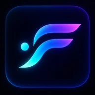

# FlowFi

**See where crypto attention is moving.**

FlowFi is building a visual discovery experience to help people explore emerging activity across crypto. Our goal is to make fast-moving signals easier to understand through clear context, intuitive visualizations, and an experience designed for discovery rather than noise.

## What we're building

- **Attention Sphere:** an interactive way to explore projects and shifts in attention.
- **Solana Market Sphere:** a central Solana hub linked to LIVE-validated and provisional Early Radar projects with observed trading activity.
- **Free Capital Intelligence:** project-level trading volume and available buy/sell transaction counts, with honest coverage and freshness labels.
- **Accessible discovery:** a compact Early Radar experience and consistent desktop and mobile project research.
- **Research and Results:** evolving chart-first project context alongside recorded outcomes, with clear distinctions between observations and predictions.

These are product directions, not a claim that every capability is publicly released. Features and scope may change as we learn.

## Follow development

This repository is our **public development journal**. We publish selected, reviewed updates about product direction, visible milestones, and opportunities to provide feedback.

- [The FlowFi vision](PRODUCT.md)
- [Conceptual showcase](SHOWCASE.md)
- [Public roadmap](ROADMAP.md)
- [Development log](DEVLOG.md)
- [Official website updates](https://flowfiengine.app/updates)
- [Community feedback](CONTRIBUTING.md)

You can **Star** this repository to support the project or **Watch** it to follow new updates.

## Latest development update

**October 12:** Our latest work makes the journey from first visit to crypto research clearer. FlowFi is refining its sign-in welcome, Getting Started checklist, guided Terminal tour, mobile navigation, and optional referral codes. We're improving chart interaction while keeping real recorded-price observations separate from any clearly labeled **synthetic chart demo (NOT LIVE)**. Results explain historical milestones more clearly, and Studio OS is progressing as a creator planning workspace. These are selected development milestones, **not** a public trading or token-launch announcement. FlowFi Pro remains coming soon. See the [development log](DEVLOG.md) for more.

## Share your ideas

[Join our first public discussion](https://github.com/flowfiengine/Flowfi-Public/issues/1) or open a GitHub Issue. Suggestions and product feedback are welcome. Please check [CONTRIBUTING.md](CONTRIBUTING.md) before posting. Never include credentials, private account details, recovery phrases, or sensitive wallet information.

## Public development, private technology

The FlowFi application and its internal engineering repository remain private. This repository contains separately authored, approved public material only. Public visibility does **not** mean the application source is open source or that brand assets are licensed for reuse.

FlowFi is an informational product in development, not financial or investment advice.

© 2026 FlowFi. All rights reserved.
